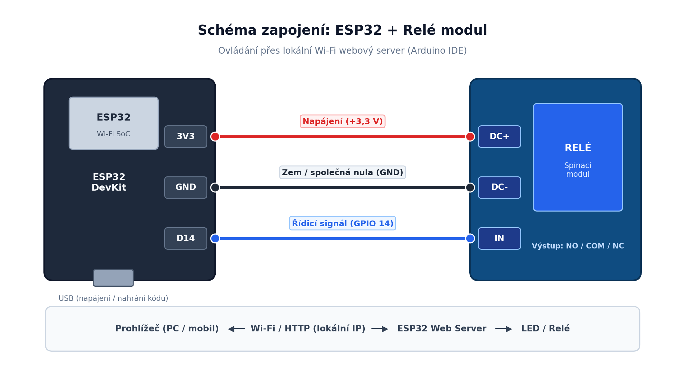

# ESP32 Wi-Fi Web Server – ovládání LED a relé modulu

Jednoduchý IoT projekt pro mikrokontroler **ESP32** napsaný v **Arduino IDE**. Zařízení se připojí k lokální Wi-Fi síti, spustí vestavěný HTTP webový server a umožní ovládat vestavěnou LED nebo externí relé modul přímo z webového prohlížeče.

## Obsah repozitáře

| Soubor | Popis |
| :--- | :--- |
| `Projekt.ino` | Webové rozhraní pro ovládání vestavěné LED na desce ESP32. |
| `projekt_rele.ino` | Webové rozhraní pro spínání externího relé modulu připojeného k ESP32. |

## Schéma zapojení (relé modul)

| Pin na ESP32 | Pin na relé modulu | Funkce |
| :--- | :--- | :--- |
| **3V3** | **DC+** | Napájení relé modulu (+3,3 V) |
| **GND** | **DC-** | Společná zem (uzemnění) |
| **D14** *(GPIO 14)* | **IN** | Řídicí signál pro spínání relé |

## Požadavky

* Deska **ESP32** (např. ESP32 DevKit)
* Relé modul a 3 propojovací vodiče *(pro variantu `projekt_rele.ino`)*
* **Arduino IDE** s nainstalovanou podporou desek ESP32

## Postup spuštění

1. Stáhněte repozitář a otevřete zvolený soubor (`.ino`) v **Arduino IDE**.
2. V kódu doplňte přihlašovací údaje k vaší lokální Wi-Fi síti (`SSID` a heslo).
3. Připojte ESP32 přes USB, zvolte správnou desku a COM port, poté klikněte na **Verify** a **Upload**.
4. Otevřete **Serial Monitor** (pravý horní roh v Arduino IDE) – po připojení k Wi-Fi se vypíše přidělená lokální IP adresa (např. `192.168.x.x`).
5. Zadejte vypsanou IP adresu do prohlížeče na počítači nebo telefonu připojeném ke **stejné Wi-Fi síti**.
